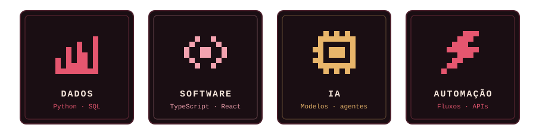

<p align="center"></p>

<p align="center"></p>

<p align="center">
  <a href="https://www.linkedin.com/in/antony-victor-946465314/"></a>
  <a href="https://www.youtube.com/@antonyvicc"></a>
  <a href="https://www.instagram.com/antonyvicc/"></a>
  <a href="https://discord.gg/z6TwHe2g"></a>
</p>

## 🍒 Sobre

```ts
const antony = {
  papel: ["Cientista de dados (certificado)", "Estudante de Engenharia de Software"],
  construindo: ["análises e modelos de dados", "ferramentas web para decisão", "automações e agentes de IA"],
  aprendendo: ["machine learning aplicado", "arquitetura de software", "MLOps"],
  stack: {
    dados: ["Python", "SQL", "pandas", "scikit-learn"],
    software: ["TypeScript", "React", "Node.js"],
  },
};
```


<p align="center"></p>

## 💼 Onde eu trabalho

**Grupo Bergano** · incorporadora
- **Viabiliza**: estudo de viabilidade de terrenos, com o terreno desenhado no mapa, custos, simulação de lotes e maquete 3D.
- **Intelligence**: painéis de dados para a diretoria acompanhar os números da empresa.
- **Financeiro**: aprovação de despesas, tesouraria e custos de obra.

**Villas Incorporadora** · Grupo Bergano
- **Central Villas**: central de atendimento com agentes de IA no WhatsApp, que qualificam o contato e passam para a equipe na hora certa.

**Reswe Digital** · HUB RW
- CRM em GoHighLevel, automações, agentes de IA, campanhas no WhatsApp, auditorias e Meta Ads para clientes.

> O código desses projetos é privado; aqui fica só o que eu faço em cada um.

## 🛠️ Stack

**Dados**<br>


**Software**<br>


**Infra e automação**<br>


## 📌 Repositórios públicos

- [**Discord**](https://github.com/AntonyVic2/Discord): bot em Node.js com comandos e banco de dados.
- [**Projeto_Ceara_Cientifico**](https://github.com/AntonyVic2/Projeto_Ceara_Cientifico): projeto de ciência de dados em Python.
- [**Testes**](https://github.com/AntonyVic2/Testes): experimentos em JavaScript com Vite e Docker.

## 📊 Atividade

<p align="center"></p>

